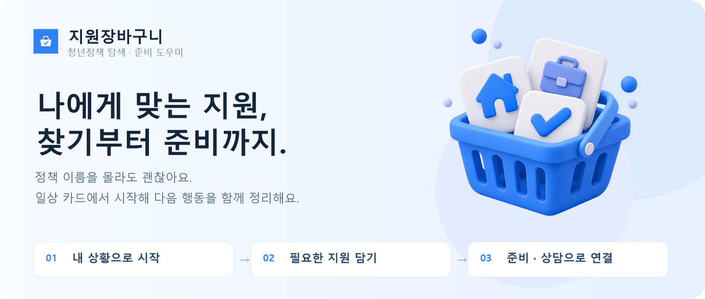
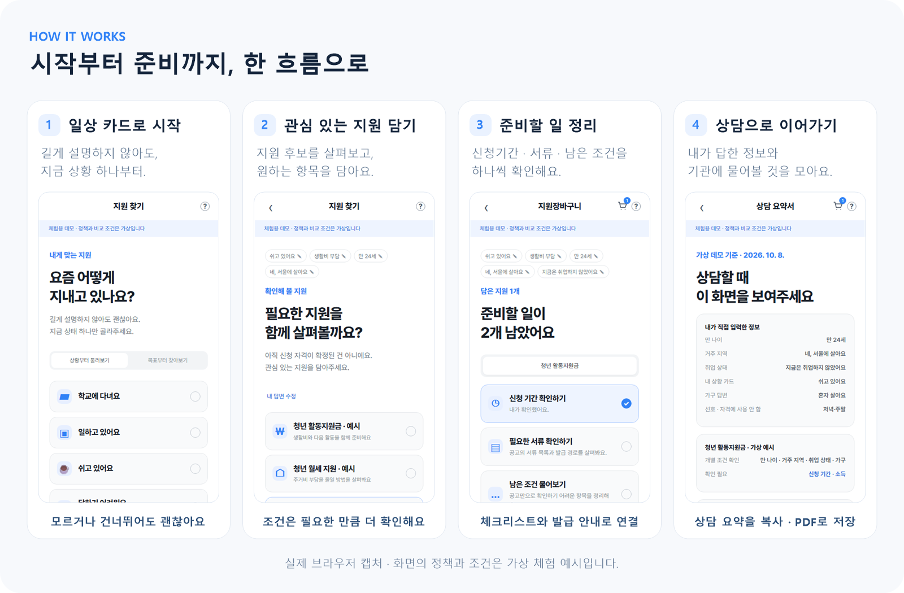
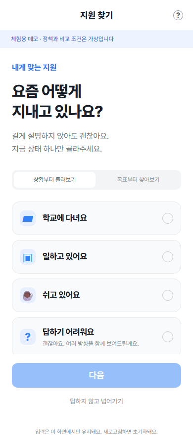
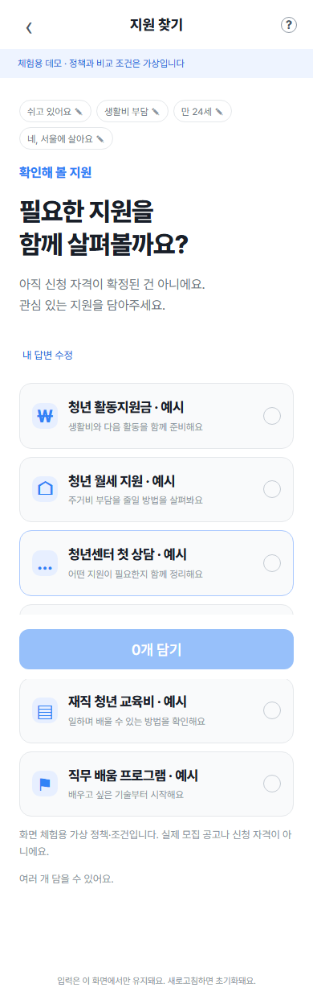
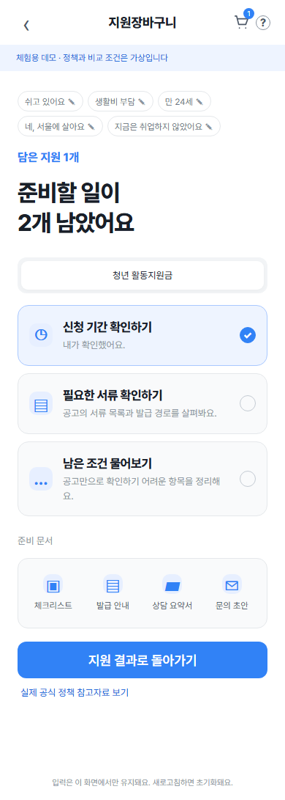
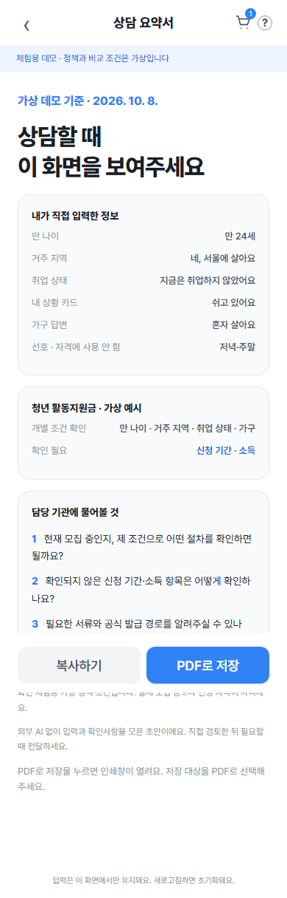

# 지원장바구니: 청년정책 AI 에이전트

**정책 이름을 몰라도, 지금 내 상황에서 시작할 수 있도록.**

지원장바구니는 일상 카드 몇 번의 선택으로 필요한 지원을 살펴보고, 관심 있는 지원의 조건 확인과 준비·상담의 첫 행동을 돕는 서비스입니다. 길게 설명하기 어렵거나 목표가 아직 정해지지 않아도 탐색을 시작할 수 있습니다.

  <a href="https://jiwon-basket.vercel.app/"><b>웹에서 바로 체험하기 ↗</b></a> &nbsp;·&nbsp;
  <a href="docs/demo/README.md">이용 안내</a> &nbsp;·&nbsp;
  <a href="docs/getting-started/README.md">직접 실행하기</a>

> 공개 웹 데모는 로그인 없이 이용하는 **가상 정책·조건 체험**입니다. 실제 정책 DB나 외부 AI를 호출하지 않습니다. 최종 신청 자격과 현재 모집 여부는 공식 공고·기관에서 확인합니다.

## 정책 검색보다 먼저, 내 상황부터

지원이 필요해도 어떤 정책이 있는지 모르거나, 내 상황을 검색어로 표현하기 어려울 수 있습니다. 정책을 찾은 뒤에도 조건과 서류를 확인하다 준비가 멈추기도 합니다.

지원장바구니는 **일상 카드 → 지원 후보 → 선택적 조건 확인 → 준비·상담**을 연결합니다. “잘 모르겠어요”와 건너뛰기를 허용하고, 이미 답한 내용은 수정할 수 있습니다. 상황 카드와 관심은 탐색의 출발점이며, 신청 자격으로 추정하지 않습니다.

## 이렇게 사용합니다

| 단계 | 이용자가 하는 일 | 서비스가 돕는 일 |
|---|---|---|
| **1. 내 상황으로 시작** | 학교·일·쉬고 있는 상황이나 관심을 선택합니다. | 답하기 쉬운 카드와 기초 질문으로 탐색을 시작합니다. |
| **2. 지원 살펴보고 담기** | 관심 있는 후보를 담고, 원할 때 상세 조건을 확인합니다. | 확인된 조건·미충족·확인 필요·입력 부족을 구분합니다. |
| **3. 준비할 일 정리** | 신청기간, 필요한 서류와 남은 조건을 확인합니다. | 체크리스트·발급 안내·문의 초안으로 다음 행동을 정리합니다. |
| **4. 상담으로 이어가기** | 상담 요약을 확인하고 복사하거나 PDF로 저장합니다. | 직접 입력한 정보와 기관에 물어볼 사항을 한곳에 모읍니다. |

화면은 실제 브라우저 캡처를 이용해 구성했습니다. 정책·조건과 입력값은 가상 체험 예시이며, 원본 전체 화면과 [캡처 출처](assets/screens/README.md)를 별도로 보관합니다.

<b>앱 화면을 크게 살펴보기</b>

<table>
  <tr><th>상황 카드로 시작</th><th>지원 후보 살펴보기</th></tr>
  <tr><td valign="top"></td><td valign="top"></td></tr>
  <tr><th>담은 지원의 신청 준비</th><th>상담 요약과 문서 저장</th></tr>
  <tr><td valign="top"></td><td valign="top"></td></tr>
</table>

## 지금 바로 체험하기

PC나 모바일에서 **[jiwon-basket.vercel.app](https://jiwon-basket.vercel.app/)**을 열면 설치 없이 이용할 수 있습니다.

1. 상황 카드에서 **“쉬고 있어요”**, 관심에서 **“생활비 부담 줄이기”**를 선택합니다.
2. 거주·나이의 기초 질문에 가상 예시로 답하고 지원 후보를 살펴봅니다.
3. 원하는 지원을 담은 뒤, 상세 확인을 진행하거나 건너뜁니다.
4. 장바구니의 준비 체크와 상담 요약을 확인합니다.

홈 화면 설치용 웹앱(PWA) 구성도 제공합니다. iPhone Safari에서는 **공유 → 홈 화면에 추가**, 지원되는 브라우저에서는 설치 메뉴를 이용합니다. [설치 방법·연결 끊김·업데이트 안내](docs/demo/pwa.md)

답변·장바구니·완료 체크는 현재 화면에서만 유지되며 새로고침하면 초기화됩니다. 오프라인 재진입에는 연결 안내만 제공하고, 정책 결과나 이전 답변을 저장하지 않습니다.

## 구현된 기능

| 기능 | 이용 경험 |
|---|---|
| **부담을 줄이는 질문** | 모름·건너뛰기, 답변 수정, 상세 확인 거절·중단·복귀를 지원합니다. |
| **조건을 구분하는 안내** | 명확한 미충족 후보는 제외하고, 불확실하거나 입력이 부족한 조건은 추가 확인으로 남깁니다. |
| **준비와 상담 연결** | 메모리 장바구니, 준비 체크, 체크리스트·발급 안내·상담 요약·문의 초안을 제공합니다. |
| **문서 가져가기** | 안내를 복사하거나 브라우저 인쇄에서 PDF로 저장할 수 있습니다. 자동 신청·예약·연락은 수행하지 않습니다. |
| **공식 자료 참고** | 실제 제도 6개의 별도 참고 목록에서 ID·공식 URL·확인일·기간 주의사항을 보여줍니다. 가상 후보의 근거와는 별개입니다. |
| **웹·홈 화면 설치** | 모바일 화면, 설치 정보·아이콘, 연결 끊김 안내와 사용자 확인 후 업데이트를 제공합니다. |

## 공개 체험과 실제 정책 API

같은 화면을 사용하되, 실행 환경에 따라 데이터와 AI 연결 범위가 다릅니다.

| 실행 환경 | 정책 데이터 | AI 사용 |
|---|---|---|
| **공개 Vercel 데모** | 화면 체험을 위한 가상 정책·조건 | 외부 AI 호출 없음 |
| **로컬 FastAPI** | 준비된 실제 정책 SQLite | 관심 기반 후보 정렬·질문 조정은 코드로 처리. 선택적 AI 설명은 설정·사용자 요청이 있을 때 기록된 근거 항목을 선택 |
| **기존 Streamlit MVP** | 수집·정규화한 정책 SQLite | OpenAI 임베딩·FAISS 검색·LLM 설명과 실패 시 기본 안내 유지 |

현재 공개 링크는 정적 데모입니다. 실제 정책 API의 공개 배포와 기기별 검증은 [개발·검증 계획](docs/development-plan.md)의 후속 범위입니다. PWA 구현과 Chromium 검사는 갖췄으며 실제 iPhone 설치·실행은 별도 수동 검증 대상입니다.

AI 설명이 규칙 판정을 바꾸거나 없는 정책·금액·기간·서류를 만들어내지 않도록 구성했습니다. 로컬 API의 선택적 AI에는 사용자 나이·지역 값이나 원문 답변을 보내지 않으며, 검증된 항목 ID로 기록된 발췌만 표시합니다. [설명 API와 설정](docs/api/intake-v1.md#출처를-연결한-설명)

## 기술과 구조

| 영역 | 구성과 역할 |
|---|---|
| **화면** | HTML · CSS · JavaScript · Pretendard, 공개 가상 체험 모드와 로컬 API 모드 |
| **API** | Python · FastAPI · Pydantic, 진행 상태·질문·조건 확인·준비 정보 연결 |
| **데이터** | 온통청년 API → 정규화 → SQLite, 정책 ID·출처·처리 시각 보존 |
| **검색·설명** | 기존 MVP의 OpenAI 임베딩 · FAISS · LLM, 로컬 API의 선택적 근거 선택과 실패 폴백 |
| **배포·검증** | Vercel 정적 데모 · 실제 API용 Docker 패키지 · GitHub Actions · Chromium 브라우저 검사 |

고정 선택과 비교 가능한 조건은 코드로 처리합니다. LLM과 데이터베이스, 화면은 조건 평가 로직에서 분리합니다. 자세한 연결은 [구조와 데이터 흐름](docs/architecture.md)에서 확인할 수 있습니다.

## 개발자 안내

| 확인하려는 내용 | 문서 |
|---|---|
| 환경 준비·실행·테스트 | [개발자 실행 안내](docs/getting-started/README.md) |
| 데모 사용·브라우저 검사 | [데모 안내](docs/demo/README.md) · [PWA 안내](docs/demo/pwa.md) |
| 데이터 흐름·모듈 구성 | [아키텍처](docs/architecture.md) |
| 요청·응답·JSON Schema | [API 규격](docs/api/intake-v1.md) |
| 실제 API 실행·배포 준비 | [API 배포 안내](docs/api/deployment.md) |
| 데이터 점검·API 연결 재현 | [데이터·API 검증](docs/validation/README.md) |
| 정책 DB 갱신·원본 감사·복구 | [정책 데이터 갱신](docs/validation/catalogue-release.md) |
| 기존 검색·LLM·Streamlit 구현 | [원본 MVP 안내](docs/mvp/overview.md) · [`v0.1-mvp`](https://github.com/yurimakes/youth-policy-llm-recommender/tree/v0.1-mvp) |
| 단계별 목표·평가·릴리스 기준 | [개발·검증 계획](docs/development-plan.md) |

<b>코드 위치 살펴보기</b>

| 경로 | 역할 |
|---|---|
| `app.py` | Streamlit MVP |
| `api.py` | 데모와 API를 제공하는 FastAPI 진입점 |
| `demo/` | 로컬 API 모드와 공개 가상 체험 모드 |
| `src/youth_policy/` | 데이터·조건 평가·검색·설명·진행 상태 모듈 |
| `scripts/` | 정책 수집·적재·갱신, API 점검, 정적 빌드, 스키마 생성 |
| `tests/` | 회귀 테스트와 브라우저 시나리오 |
| `assets/readme/` | README용 서비스 소개·이용 흐름 이미지와 편집 원본 |
| `assets/screens/` | 실제 브라우저 화면 캡처 원본 |

## 검증과 다음 단계

[GitHub Actions의 Demo checks](https://github.com/yurimakes/youth-policy-llm-recommender/actions/workflows/demo-checks.yml)는 Windows Python 회귀, JavaScript 시나리오, 정적 빌드와 Chromium 브라우저 흐름을 검사합니다. 실행별 결과와 화면 PNG·상담 PDF는 해당 실행에서 확인합니다.

[데이터·API 검증](docs/validation/README.md)은 API 키 없이 예제 정책 10개를 SQLite에 적재하고 실제 FastAPI의 13개 연결·동작 검사를 재현합니다. 소스·데이터 해시와 원본 추적 결과를 남기며, 실제 로컬 DB의 필드·기간·출처·원본 행을 읽기 전용으로 점검할 수 있습니다. 예제 재현과 브라우저 검사는 실제 공고의 최신성이나 최종 자격을 보증하지 않습니다.

현재 **G1 기반 구축을 완료**했고 다음 단계는 **G2 정책 데이터·규칙 검증**입니다. 정책 범위 검증, 질문 개인화, 근거 검색과 웹/PWA 운영 검증을 2026년 12월까지 순차 고도화할 계획입니다. 정답 사례 100건 이상·근거 일치율 95% 등은 달성 실적이 아닌 [후속 평가 목표](docs/development-plan.md)입니다.

## 데이터와 이용 조건

주요 데이터 출처는 [온통청년](https://www.youthcenter.go.kr/) 청년정책 API입니다. 정책 ID·공식 URL·확인 시각을 보존합니다. `last_verified_at`은 적재·처리 시각이며, 담당 기관이 모든 조건을 재확인했다는 뜻이 아닙니다.

API 키·raw 데이터·로컬 DB·실제 사용자 답변은 공개 저장소에 포함하지 않습니다. 공식 데이터의 이용·재배포 조건과 코드 라이선스는 별도로 확인해야 하며, 현재 코드 라이선스는 지정되지 않았습니다. [글꼴 출처·라이선스](docs/demo/fonts.md)
